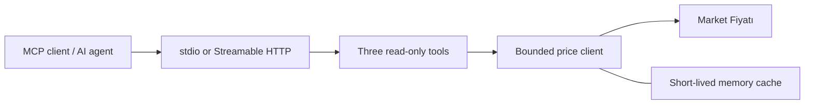

# Market Fiyatı MCP

[Türkçe](README.md) | **English**

**Grocery price tools for MCP-compatible AI clients.**

[](https://github.com/enesoglu/market-fiyati-mcp/actions/workflows/ci.yml)

[](LICENSE)

Search Turkish grocery prices from [Market Fiyatı](https://marketfiyati.org.tr/)
using an AI agent or another [Model Context Protocol](https://modelcontextprotocol.io/)
client. The server is independent of the client's model and vendor.

Run it on Windows, macOS or Linux, in a container, or on a hosted container platform.
**Local use requires no account, domain, inbound port or cloud service.**

> Unofficial project, not affiliated with Market Fiyatı or its operators.
> Price availability, coverage and freshness depend on the upstream provider.

## Choose your setup

| Scenario | Transport / authentication | Guide |
| --- | --- | --- |
| An agent runs on your computer | stdio; local process access | [Local installation](docs/local.md) |
| A client needs a localhost URL | Streamable HTTP; loopback only | [HTTP connections](docs/http.md) |
| An agent connects to another machine | HTTP with bearer token or OAuth | [HTTP connections](docs/http.md) |
| You prefer Docker | stdio or HTTP; optional persistent OAuth state | [Containers](docs/containers.md) |
| A managed platform supplies an HTTPS URL | Stateless bearer HTTP; platform port | [Cloud hosting](docs/cloud.md) |

An LLM accesses these tools through an MCP client or agent framework. Compatibility
depends on the client's transport and authentication support, not its model brand.

## Quick start

Python 3.13+:

```sh
git clone https://github.com/enesoglu/market-fiyati-mcp.git
cd market-fiyati-mcp
python -m pip install .
market-fiyati-mcp --client-config
```

Use a virtual environment for an isolated installation. The optional installers do
that for you:

```powershell
# Windows PowerShell
.\setup\install.ps1
```

```sh
# macOS / Linux
sh setup/install.sh
```

Both print the command that generates your local client configuration. See the
[local guide](docs/local.md) for configuration examples and installation from source.

## Tools

| Tool | Input | Result |
| --- | --- | --- |
| `search_products` | Keywords; optional explicit location | Matching products and store offers |
| `find_product` | Provider product ID or barcode | Identity-based lookup |
| `find_similar_products` | Product ID and keywords | Provider-suggested alternatives |

For example: “Süt 1 litre seçeneklerini ara; fiyatları miktarlarıyla birlikte karşılaştır.”

Location filtering takes latitude, longitude and radius in **meters**, supplied
together. The server does not infer your location. Responses include:

- Decimal TRY prices, package quantity/unit and store information.
- UTC retrieval time, provider price timestamps and cache status.
- Explicit result/offer truncation and provider-reported match counts.

The cheapest **returned** offers are sorted first. Alternatives are not exact
matches, and provider prices are not checkout guarantees.

## HTTP without a domain

For a client on the same computer:

```sh
market-fiyati-mcp --transport http
```

Connect to `http://127.0.0.1:8000/mcp`. This mode binds only to loopback and refuses
a nonlocal unauthenticated configuration.

For a different machine, use an SSH connection/tunnel, an HTTPS-capable IP endpoint,
or a hosting platform's supplied HTTPS URL. A custom domain is optional. Public
HTTP must use bearer authentication or OAuth; see [connection examples](docs/http.md).

## Design



- Three fixed upstream operations; no arbitrary URL fetch or write tools.
- Async requests, bounded cache/response sizes, timeouts and limited retries.
- Provider failures remain explicit errors rather than empty search results.
- Stateless bearer mode; persistent encrypted state only when OAuth is selected.
- No application access logs containing searches, locations or credentials.
- Tests cover real MCP handshakes, HTTP profiles, OAuth and provider failures.

Read [Architecture](docs/architecture.md), [Configuration](docs/configuration.md),
[Security](SECURITY.md) and [Contributing](CONTRIBUTING.md).

## Limits

This server queries an undocumented upstream interface. It may change or rate limit
requests. The project does not bypass provider restrictions, promise complete
coverage, bulk export prices or create a historical price database.

The service is operator-managed, not a multi-user account platform. Bearer access
is shared by clients holding that token; OAuth grants are individually revocable.
Monitoring, TLS termination and backups belong to the chosen hosting environment.
