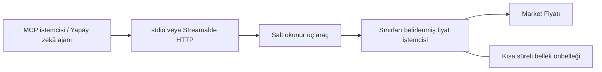

# Market Fiyatı MCP

**MCP uyumlu yapay zekâ istemcileri için market fiyatı araçları.**

[](https://github.com/enesoglu/market-fiyati-mcp/actions/workflows/ci.yml)

[](LICENSE)

Bir yapay zekâ ajanı veya başka bir [Model Context Protocol](https://modelcontextprotocol.io/)
istemcisi aracılığıyla [Market Fiyatı](https://marketfiyati.org.tr/) üzerinden Türkiye'deki
market fiyatlarını arayın. Sunucu, istemcinin kullandığı modelden ve sağlayıcıdan bağımsızdır.

Windows, macOS veya Linux üzerinde, bir container içinde ya da container barındırma
platformunda çalıştırabilirsiniz.
**Yerel kullanım için hesap, alan adı, dışarıdan erişime açık port veya bulut hizmeti gerekmez.**

> Bu proje resmî değildir; Market Fiyatı veya hizmetin işletmecileriyle bağlantısı yoktur.
> Fiyatların erişilebilirliği, kapsamı ve güncelliği kaynak veri sağlayıcısına bağlıdır.

## Kurulum seçeneğinizi belirleyin

| Senaryo | İletişim yöntemi / kimlik doğrulama | Rehber |
| --- | --- | --- |
| Ajan bilgisayarınızda çalışıyor | stdio; yerel süreç erişimi | [Yerel kurulum](docs/local.md) |
| İstemcinin bir localhost URL'sine ihtiyacı var | Streamable HTTP; yalnızca loopback | [HTTP bağlantıları](docs/http.md) |
| Ajan başka bir makineye bağlanıyor | Bearer token veya OAuth ile HTTP | [HTTP bağlantıları](docs/http.md) |
| Docker kullanmayı tercih ediyorsunuz | stdio veya HTTP; isteğe bağlı kalıcı OAuth durumu | [Container kullanımı](docs/containers.md) |
| Yönetilen bir platform HTTPS URL'si sağlıyor | Durum tutmayan (stateless) bearer HTTP; platformun portu | [Bulutta barındırma](docs/cloud.md) |

Bir LLM bu araçlara MCP istemcisi veya ajan framework'ü üzerinden erişir. Uyumluluk,
modelin markasına değil, istemcinin iletişim yöntemi ve kimlik doğrulama desteğine bağlıdır.

## Hızlı başlangıç

Python 3.13+:

```sh
git clone https://github.com/enesoglu/market-fiyati-mcp.git
cd market-fiyati-mcp
python -m pip install .
market-fiyati-mcp --client-config
```

İzole bir kurulum için sanal ortam (virtual environment) kullanın. İsteğe bağlı kurulum
betikleri bunu sizin için yapar:

```powershell
# Windows PowerShell
.\setup\install.ps1
```

```sh
# macOS / Linux
sh setup/install.sh
```

Her iki betik de yerel istemci yapılandırmanızı oluşturan komutu ekrana yazdırır.
Yapılandırma örnekleri ve kaynak koddan kurulum için [yerel kurulum rehberine](docs/local.md) bakın.

## Araçlar

| Araç | Girdi | Sonuç |
| --- | --- | --- |
| `search_products` | Anahtar kelimeler; isteğe bağlı olarak açıkça belirtilen konum | Eşleşen ürünler ve mağazalardaki fiyat teklifleri |
| `find_product` | Sağlayıcının ürün ID'si veya barkod | Ürün kimliğine göre sorgulama |
| `find_similar_products` | Ürün ID'si ve anahtar kelimeler | Sağlayıcının önerdiği alternatifler |

Örneğin: “Süt 1 litre seçeneklerini ara; fiyatları miktarlarıyla birlikte karşılaştır.”

Konuma göre filtreleme için enlem, boylam ve **metre** cinsinden yarıçap birlikte
verilmelidir. Sunucu konumunuzu kendiliğinden belirlemez. Yanıtlarda şu bilgiler yer alır:

- Ondalıklı TRY fiyatları, paket miktarı/birimi ve mağaza bilgileri.
- UTC cinsinden verinin alınma zamanı, sağlayıcının fiyat zaman damgaları ve önbellek durumu.
- Sonuçların/fiyat tekliflerinin sınır nedeniyle kısaltılıp kısaltılmadığı ve sağlayıcının bildirdiği eşleşme sayıları.

**Dönen sonuçlar içindeki** en ucuz fiyat teklifleri önce sıralanır. Alternatifler birebir
ürün eşleşmesi değildir; sağlayıcının bildirdiği fiyatlar kasada aynı fiyatın uygulanacağını garanti etmez.

## Alan adı olmadan HTTP kullanımı

Aynı bilgisayardaki bir istemci için:

```sh
market-fiyati-mcp --transport http
```

`http://127.0.0.1:8000/mcp` adresine bağlanın. Bu mod yalnızca loopback adresini dinler;
bu bilgisayar dışından erişime izin veren, kimlik doğrulamasız bir yapılandırmayı reddeder.

Başka bir makineden erişmek için SSH bağlantısı/tüneli, HTTPS destekleyen bir IP uç noktası
veya barındırma platformunun sağladığı HTTPS URL'sini kullanın. Özel alan adı isteğe bağlıdır.
Dışarıya açık HTTP erişiminde bearer kimlik doğrulaması veya OAuth kullanılmalıdır;
[bağlantı örneklerine](docs/http.md) bakın.

## Tasarım



- Kaynak sağlayıcıya yönelik üç sabit işlem; rastgele URL'lerden veri çekme veya yazma aracı yoktur.
- Asenkron istekler, sınırlı önbellek/yanıt boyutları, zaman aşımı ve sınırlı yeniden deneme.
- Sağlayıcı hataları boş arama sonucu olarak gizlenmez; açıkça hata olarak döndürülür.
- Bearer modu durum tutmaz; kalıcı ve şifreli durum verisi yalnızca OAuth seçildiğinde kullanılır.
- Aramaları, konumları veya kimlik doğrulama bilgilerini içeren uygulama erişim logları tutulmaz.
- Testler gerçek MCP el sıkışmalarını, HTTP profillerini, OAuth'u ve sağlayıcı hatalarını kapsar.

[Mimari](docs/architecture.md), [Yapılandırma](docs/configuration.md),
[Güvenlik](SECURITY.md) ve [Katkıda bulunma](CONTRIBUTING.md) belgelerini inceleyin.

## Sınırlamalar

Bu sunucu, kaynak sağlayıcının belgelenmemiş bir arayüzünü sorgular. Bu arayüz değişebilir
veya isteklere hız sınırı uygulayabilir. Proje, sağlayıcının kısıtlamalarını aşmaz;
tüm ürün ve mağazaları kapsama sözü vermez, fiyatları toplu olarak dışa aktarmaz
ve geçmiş fiyat veritabanı oluşturmaz.

Hizmet, işletmecisi tarafından yönetilir; çok kullanıcılı bir hesap platformu değildir.
Bearer token'a sahip istemciler aynı erişimi paylaşır; OAuth yetkilendirmeleri ise tek tek
iptal edilebilir. İzleme, TLS sonlandırma ve yedeklemeler seçilen barındırma ortamının sorumluluğundadır.
